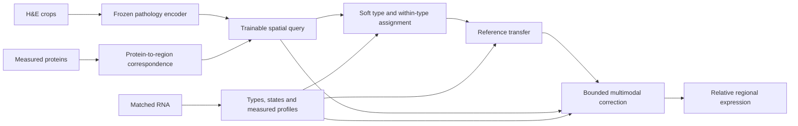

# Personalized HEIR workflow

This revision applies the user-supplied **HEIR software development plan** to the existing
repository. The development target is a specimen-specific probabilistic RNA-state assignment at
H&E nuclei, constrained by measured proteins and geometry, followed by relative-expression
prediction. Spatial transcriptomics (ST) supervises and evaluates that same pathway during
development. It is not an ordinary prediction input.

The package is an engineering prototype. Synthetic contract tests can verify calculations and
input separation; they cannot qualify an HTAPP specimen, establish spatial resolution, or support
a positive biological claim. The historical HEST, NatCommun, and GSE315411 results and protocol
identities remain unchanged.

The pre-cleanup repository passed **913 tests**. That broader implementation, its original
review, and its scientific records are preserved in the [source archive](../archive/README.md).
The initial compact prototype at `d955c01` passed **53 focused tests**. Version 0.3 adds regression
tests for the assessment's numerical and identity failures; that earlier pass did not exclude them.
Its synthetic H5AD/Parquet workflow covers preparation, fitting, bundle reload, target-free
prediction, and scoring on CPU. These checks establish engineering behavior only; they are not
real-data, GPU, or biological qualification.

Retained frozen encoder adapters live in `heir.features`. Historical study-specific validation,
prototype, and evaluation code is preserved in the archive rather than maintained as an active
runtime dependency. Its exact-block matching assumptions must not be substituted for HTAPP's
patient, episode, lesion, represented-region, core, and section evidence.

## Prediction and target contract

| Information | Training | Held-out personalized prediction |
| --- | --- | --- |
| H&E nuclei, physical coordinates, cached image features | Input | Input |
| Documented specimen-matched sc/snRNA | Input | Input |
| Measured proteins, availability masks, marker interpretation, registration | Input when the arm uses proteins | Input when the arm uses proteins |
| Predefined LR resources | Input in LR comparisons | Input in LR comparisons |
| Measured spatial RNA | Supervision | Evaluation after prediction |
| Spatial-RNA-derived labels, `RCTD`, `OT`, transferred annotations | Only explicitly declared training/evaluation use | Excluded from ordinary prediction inputs |

Matched RNA may contain the genes being predicted: the personalized task is to place its molecular
information correctly in space. The prediction API must never read target ST to construct the
assignment, select a reference, define a protein feature, or determine an evaluation compartment.
The H&E-only arm must be independent of RNA and protein values.

For each H&E nucleus the output contract includes its ID and coordinates; state probabilities with
an explicit unsupported-reference component; conditional known-state probabilities;
reference-transferred expression; bounded learned
log correction; final relative expression; assignment ambiguity and reference support; registration
sensitivity when measured; and gene-level supervision/evaluation flags. Missing registration
sensitivity must remain missing, not a false claim of zero sensitivity. Model variability is a
separate repeated-fit quantity.

In personalized arms, genes without spatial training supervision retain reference transfer with
zero learned correction. The H&E-only arm supports its spatially supervised genes only.
Reference support is diagnostic only. The unsupported head is zero-initialized and frozen until a
qualified support objective exists. Transfer, message passing, refinement, protein discrepancies,
and specimen abundance all use conditional known-state probabilities, computed directly by a
known-state softmax to remain stable even when joint support numerically reaches zero. All cells
therefore retain expression contributions; support cannot suppress an inconvenient cell's RNA.
Exports label this provisional policy `conditional_reference_unvalidated` and set
`reference_support_calibrated=false`. This conditional reference extrapolation is not a validated
prediction for truly unsupported cells. Absolute molecule counts and calibrated expression
intervals require additional measurement and validation models.

### Fixed normalization and spatial endpoints

Model configuration separates `normalization_gene_ids` from `supervised_gene_ids`; the evaluation
command's `--genes` (alias `--evaluation-genes`) selects outcomes only. The normalization panel is
saved in the bundle and is reused from prediction provenance when scoring. The contract is:

1. Aggregate nonnegative linear cell expression into assay regions.
2. Divide by the sum over the fixed normalization panel, scale to 10,000, and apply `log1p`.
3. Select supervised/evaluation genes and apply their outcome-availability mask.

Every normalization gene must be measured in every retained region, and both prediction and target
denominators must be positive. Incomplete coverage is rejected; users must qualify a common complete
panel/coverage before running a comparison. Missing outcomes outside that panel do not change its
denominator. Changing the outcome subset therefore cannot redefine an existing gene's scale.

A panel needs at least two distinct genes. One supervised gene is allowed with a separate
normalization basis; training rejects an effectively one-gene denominator with no measured and
initially predicted companion mass in any common training region. Individual sparse regions remain
valid. H&E-only models must supervise every normalization gene because they have no RNA transfer
for untrained genes. Exposure-based/count normalization is not implemented.

`score()` computes gene-wise spatial correlations within one specimen. `score_patient()` first
computes each specimen's median gene-wise correlation, then gives eligible specimens equal weight
in `mean_specimen_median_gene_spearman`. Between-specimen mean differences cannot create this
spatial endpoint. Reports retain per-specimen gene exclusions; a constant prediction for a
target-evaluable gene invalidates the headline rather than selecting a favorable subset.

## Package boundaries

The active inference modules live in `src/heir/personalized/`; optional frozen encoder adapters
remain in `src/heir/features/`. Historical study implementations are retained in the source archive.

| Module | Responsibility |
| --- | --- |
| `schema.py` | Validate and separate `PredictionInputs`, `RNAReference`, protein evidence, graph geometry, `SpatialTargets`, and `Prediction` |
| `data.py` | Read explicitly described local inputs and keep target loading separate |
| `geometry.py` | Directed coordinate transforms, physical units, regional protein evidence, and inspection overlays |
| `reference.py` | Construct specimen RNA prototypes and means on a nonnegative linear scale |
| `graph.py` | Sparse directed neighborhoods, generic messages, and complex-aware LR compatibility |
| `model.py` | Shared assignment, optional bounded refinement, reference transfer, and expression correction |
| `observation.py` | Aggregate cell expression into measured regions on the linear scale |
| `train.py` | Shared supervised optimization and model persistence |
| `evaluate.py` | Join completed predictions to separate targets and report explicit metric eligibility |
| `serialization.py` | Validate prediction axes and values, preserve supplied provenance, and write/read pickle-free NPZ exports |
| `cli.py` | Preparation, training, prediction, and evaluation entry points |
| `cohort.py` / `cohort_cli.py` | Registered HTAPP tissue-region preparation and workflows |
| `region_features.py` | Frozen encoder crops and verified regional feature caches |
| `inspection.py` | H&E and assay overlays with exact coverage and exclusion tables |
| `diagnostics.py` | Fixed-fit correction, protein intervention, coverage, and replicate diagnostics |
| `study.py` | Frozen patient folds, validation selection, training-only reference control, and paired patient reporting |
| `error_decomposition.py` | Fixed-scale mean-bias and centered-error decomposition with evaluator weights |
| `consistency.py` | Cohort replicate coverage/consistency and actual protein-pathway diagnostics |
| `reconstruction.py` / `capability.py` | Target-informed simplex reference fits and a separate bound capability analysis |

### Small-workflow commands

Install the core and the optional HTAPP file readers (`--extra encoders` adds frozen image adapters):

```bash
uv sync --frozen --extra dev --extra htapp
```

Start from the [specimen manifest](../configs/personalized/htapp.example.json) and
[model configuration](../configs/personalized/model.example.json), replacing their placeholders and
dimensions with the qualified specimen inputs. The
[comparison plan](../configs/personalized/comparisons.json) records the seven variants, decisive
contrasts, and shared requirements; it is a comparison index rather than a model JSON accepted by
`--config`.

The CLI keeps prediction separate from target loading:

```bash
heir prepare --manifest specimen.json --output prepared/
heir train --manifests train-specimen-1.json train-specimen-2.json \
  --folds folds.csv --outer-fold 0 --config model.json --output bundle/
heir predict --manifest held-out-specimen.json --bundle bundle/ --output predictions.npz
heir evaluate --prediction predictions.npz --manifest held-out-specimen.json \
  --genes evaluation-genes.json --output scores.json
```

All four context variants (`generic_fixed`, `lr_fixed`, `generic_refined`, `lr_refined`) require
`heir train ... --baseline protein-bundle/`, pointing to the same fitted `he_rna_protein` baseline
for a controlled comparison. Their model JSON must supply the same explicit `lr_interactions`
programs for generic and LR arms. The base mapper and its image-feature transform are copied and
frozen; refined variants learn their additional bounded assignment updates.

Use `heir predict ... --transfer-only --output transfer-only.npz` to export a fitted personalized
model's transfer-only diagnostic. Training a fixed-context transfer-only model is rejected because
its frozen mapper leaves no decoder to optimize. H&E-only prediction has no transfer diagnostic.
Training and prediction accept `--device cpu` (the default) or `--device cuda` for a locally
available CUDA device. Model fitting and regression checks have run on CPU. Version 0.5 also ran
the retained frozen H-optimus-1 encoder on local CUDA; that does not qualify CUDA model training.

Paths in these commands are examples and require actual qualified local input files. The manifest
identifies the sparse cell-to-observation NPZ through `paths.observation`, including explicit cell
and observation identifiers. `folds.csv` supplies patient roles `train`, `validation`, and `test`
for the selected outer fold. Training reads targets only for the training specimens. Model
selection and a complete outer-fold study remain distinct from executing one training command.
The training CLI performs the requested fit; it does not perform hyperparameter selection or
training resumption. Bundles retain the training configuration, manifests, and optimizer state for
future reproducibility/resumption work, while inference loads numeric weights and transforms.
`prepare` creates an input summary/eligibility record and geometry overlay without opening target
ST. That target-free diagram is not the complete multimodal acceptance overlay.

Version 0.3 introduced specimen manifest, bundle, and prediction schema v2. Old v1 model weights are
not silently loaded under the changed numerical semantics: update the normalization panel and
protein/registration identities, replace protein `radius_um` with declared bin geometry, and
prepare/refit/export again. The archived v1 evidence remains unchanged.

Version 0.4 retains canonical manifest/bundle v2 and writes prediction v3 with generic
`coordinates`, explicit `prediction_unit` (`nucleus` or `tissue_region`), and `coordinate_units`
(`um` or `registered_pixel`). Existing v2 predictions load as nucleus/µm. Saved models reject
inputs whose spatial units differ from training. The Python `coordinates_um` field remains a
legacy compatibility name; new code uses `coordinates` together with the declared units.

Version 0.5 carries units into graph distances and interaction cutoffs. Graph `distance_units` and
interaction `radius_units` must be `um` or `registered_pixel`. The legacy `distances_um` and
`radius_um` fields retain their names, but their numerical values use the explicitly declared
units. An omitted interaction unit means `um`, preserving the canonical physical workflow.
A pixel graph rejects such a program unless a positive, independently established
`micrometres_per_pixel` calibration is provided. Conversion affects the cutoff comparison only;
it does not rescale coordinates or graph weights. The regional adapter supplies no calibration.
Regional context experiments must therefore declare `"radius_units": "registered_pixel"` on
each interaction. Configuration, bundles, and prediction provenance preserve these units.

For a synthetic integration fixture, use:

```bash
heir demo --output /tmp/heir-personalized-demo
```

The demo is a software check, not an HTAPP result. Prediction exports currently materialize dense
expression arrays and are intended for small development specimens. The bundle preserves fitted
model state and configuration; reproducing a scientific prediction also requires retaining the
matched-reference inputs, preparation settings, mapping metadata, and cached-feature identities.

Segmentation and image encoding remain preprocessing tasks. The canonical core consumes cached,
nucleus-ID-keyed features; version 0.5 connects the retained frozen encoder to the regional path
with source and crop provenance. A new CellViT adapter, automated two-scale physical crops, and
nucleus-feature qualification remain future work. Existing studies retain their recorded
H-optimus-1/UNI2-h roles and checkpoint identities. The attached plan's optional UNI2-h suggestion
does not rewrite those studies.

## HTAPP qualification

The attached plan identifies the [SCP2702 portal](https://singlecell.broadinstitute.org/single_cell/study/SCP2702)
and a previous 13-participant intersection as the candidate source. On October 26, 2026, the user
located the acquired working set at `/mnt/seagate/HnE/HTAPP_MBC`. All 387 paths in
`metadata/selected_13_verified_file_manifest.tsv` are present with matching file sizes, totaling
15,708,049,238 bytes across 13 biopsies. They include 156 H5ADs, 153 compressed TSVs, and 78 H&E
images; each biopsy has H&E, independent RNA, CODEX, and Slide-seq. Fifteen reused metadata and
inspection files match their recorded SHA-256 hashes. Biological payload hashes were not recomputed
in this follow-up; acquisition/readback receipts remain in the dataset. File presence does not
establish scientific eligibility.

The local `README.md`, `DOWNLOAD_COMPLETE.json`, and `inspection/INITIAL_INSPECTION.md` distinguish
completed acquisition from training readiness. The registered pilot measurement axes were checked
directly in HDF5:

| Biopsy | Independent RNA cells × genes | Slide-seq observations × genes | Shared RNA genes | CODEX cells × markers |
| --- | --- | --- | --- | --- |
| 313-932 | 12,494 × 21,081 | 11,484 × 17,023 | 13,612 | 30,005 × 50 |
| 514-6760 | 20,916 × 26,822 | 33,272 × 20,944 | 15,462 | 35,995 × 50 |

Registered retained measurements use `obsm["counts"]` with `uns["counts_var"]`; processed RNA
`X` has only 5,000 features and is not the count axis. HEIR's `extract_raw_counts` successfully
loaded and validated the 313-932 RNA matrix as sparse CSR, without densifying it. These are
independent-RNA integer counts after upstream filtering/CellBender processing, not untouched raw
UMI data. The source manifests keep molecular inputs separate from spatial targets. Imported OT/RCTD
outputs and molecular embeddings are not H&E image features or approved prediction inputs.

Inspected RNA-label ancestry traces to the dissociated-RNA workflow (clustering, SingleR/CNV,
and manual annotation), with no spatial-label feedback found along that path. However, those
labels include cohort-level processing rather than training-fold-only fitting; their reuse must
be declared explicitly for a held-out experiment. This inspection does not approve every imported
annotation field.

The clean pinned processing checkout at `reference/HTAPP-Pipelines`, commit
`eac56009691ab3a2bf5b56c34e82683f90cf0141`, supplies an author-declared common physical frame.
`HTAPP_MBC/03_spatial_analysis/spatial_utils.py` and the pilot processing notebooks explain the
coordinate transforms. Paired source/registered coordinates reproduce CODEX scales of 0.386 for
313-932 and 0.772 for 514-6760 (the latter notebook doubles half-resolution coordinates), and a
Slide-seq scale of 0.6 for both pilots. `02_HE.ipynb` labels 100 processed-image pixels as 100 µm.
These source conventions are not independently verified scanner calibration. In particular,
`spatial_utils.py` explicitly notes that Slide-seq should use 0.65 instead of the implemented 0.6;
this discrepancy must be resolved with the registration before using physical bins. Do not scale
already registered coordinates a second time or change their scale without requalifying alignment.

The working set contains no H&E nucleus segmentation, nucleus-keyed frozen image features, or
cell-to-spatial-observation map. CODEX cell coordinates cannot substitute for independently
identified H&E nuclei. Stored `00_matchSpatial.ipynb` output identifies CODEX source section 3 for
313-932 and section 8 for 514-6760. It does not establish the corresponding H&E/Slide-seq sections,
core identities, or their relationships to independent RNA. The referenced
`sampletracking_HTAPP_MBC_spatial.csv` is absent from this checkout; assay replicate numbers must
not be substituted for biological section IDs. These links, antibody-to-gene interpretation, and
common tissue coverage still require qualification. The final eligibility table must retain
explicit reasons for incomplete or unresolved specimens.

### HTAPP tissue-region workflow

The user selected tissue regions as the initial cohort resolution. This profile uses the
publication's biopsy grouping and preserves unknown section/core details as unknown. It does not
require invented identifiers to satisfy the stricter nucleus-oriented canonical manifest.
The registered canvas is the analysis frame: existing coordinates are used unchanged in
`registered_pixel` units. Physical calibration uncertainty remains relevant to µm-scale or
same-cell claims, but does not prevent this explicitly regional development workflow.

`regions.py` selects a fixed grid from processed H&E image 1 alone, defaulting to 100-pixel bins.
Tissue fraction uses fixed saturation/intensity thresholds, and disconnected selected bins have
separate components. Arrays follow the published lower-origin convention without an extra flip.
Neither CODEX nor target RNA selects regions or computes image features. The default retains
the existing 12-feature handcrafted RGB control. Version 0.5 also supports verified frozen
H-optimus-1 features on the identical grid.
Region assignments describe reference-state mixtures at tissue locations, not cell placements;
cell-abundance regularization is disabled for this profile.

The [cohort configuration](../configs/personalized/cohort.json) keeps an 18-gene RNA embedding
separate from nine shared supervised/normalization outcomes: EPCAM, KRT8, KRT18, KRT19, VIM,
COL1A2, DCN, CD8A, and MKI67. These outcomes are present on the retained axes of all 13 biopsies;
their selection used availability rather than expression scores. RNA prototypes still normalize
over the full measured RNA library before selecting output genes. Larger explicitly specified
panels are supported when their measured coverage passes the same checks; this initial run is
not a transcriptome-wide benchmark.

Protein evidence uses the original panel's unambiguous CD4/CD4, CD8/CD8A, CD45/PTPRC,
CD31/PECAM1, and Ki67/MKI67 pairs. Ambiguous or conflicting mappings, including CD25/ISG20,
are excluded. Fixed saturating transforms and their cofactors are recorded in configuration and
provenance; their RNA/protein calibration remains unvalidated. Uniform regional protein means
have a dedicated observation operator. Availability indicators do not claim registration confidence.

Slide-seq counts are summed within each existing H&E region separately for each assay replicate.
Regions with incomplete or zero fixed-panel exposure are excluded with explicit IDs, identically
for every comparison. Training weights measured genes within replicates, replicates within each
biopsy, and biological patients equally. Evaluation computes spatial correlations separately per
replicate before reporting `mean_replicate_median_gene_spearman`; between-replicate means cannot
produce spatial accuracy. All regions and replicates from a patient share one fold.

The adapter verifies SHA-256 for each consumed source payload. Prediction opens only H&E,
independent RNA, and CODEX; it works with target payloads removed or changed. Evaluation reuses
the saved grid and opens only the spatial target payload. Source archives, extracted data, and
acquisition receipts remain unchanged. Published RNA-only labels are an explicitly declared
cohort-curated reference resource, not training-fold-fitted preprocessing.

```bash
heir cohort-inspect --root /mnt/seagate/HnE/HTAPP_MBC --output cohort-setup/
heir cohort-demo --root /mnt/seagate/HnE/HTAPP_MBC --biopsy 313-932 \
  --config configs/personalized/cohort.json --output pilot-regions/
heir cohort-train --root /mnt/seagate/HnE/HTAPP_MBC \
  --config configs/personalized/cohort.json --folds cohort-setup/folds.csv \
  --outer-fold 0 --output regional-bundle/
heir cohort-predict --root /mnt/seagate/HnE/HTAPP_MBC --biopsy 330-1082 \
  --bundle regional-bundle/ --output regional-prediction.npz
heir cohort-evaluate --root /mnt/seagate/HnE/HTAPP_MBC \
  --prediction regional-prediction.npz --output regional-scores.json
```

`cohort-inspect` writes inventory, configuration, and deterministic candidate patient folds;
it does not certify fold balance or read target expression. `cohort-demo` fits H&E-only,
RNA-guided, and protein-guided models on one biopsy, then exports and scores full and transfer-only
predictions. Its scores are explicitly `development_in_sample`. Each score reports CD8A/MKI67
separately from the other seven default outcomes using the same nine-gene normalization basis
and eligible rows. These groups describe direct marker overlap, not biological independence.
The run summary also reports mean absolute learned log correction. `cohort-train` reads target
payloads only for training patients; `cohort-predict --transfer-only` preserves the fitted mapper.
The original canonical commands continue to support independently prepared H&E nuclei and frozen
encoder features.

### Regional inspection and frozen image features

```bash
heir cohort-inspect-pilot --root /mnt/seagate/HnE/HTAPP_MBC --biopsy 313-932 \
  --config configs/personalized/cohort.json --output pilot-inspection/
heir cohort-features --root /mnt/seagate/HnE/HTAPP_MBC --biopsies 313-932 \
  --config configs/personalized/cohort.json \
  --encoder-manifest manifests/encoders/hoptimus1.json \
  --model-dir /mnt/seagate/HnE/pretrained/H-optimus-1 \
  --device cuda --batch-size 1 --output frozen-region-features/
heir cohort-demo --root /mnt/seagate/HnE/HTAPP_MBC --biopsy 313-932 \
  --config frozen-region-features/config.json --epochs 100 --seed 0 \
  --output frozen-feature-pilot/
```

`cohort-inspect-pilot` builds the H&E grid first, then deliberately opens targets for coverage
inspection. Its self-contained HTML provides separate CODEX and Slide-seq replicate overlays,
source points, target exposure, marker availability, exact region tables, and exclusion reasons.
H&E and points share the authors' lower-origin display convention. Displayed source points are
bounded to 8,000 per replicate; tables and coverage counts use all observations. `regions.tsv`
and `summary.json` retain exact results. Visual review can identify coverage problems; it does
not certify registration accuracy, physical calibration, or same-cell correspondence.

`cohort-features` opens source H&E and source metadata only. It verifies the retained checkpoint
and configuration against the encoder manifest. Each selected grid bin supplies one crop, clipped
at image edges without padding or geometry flips, then resized once to the manifest's 224-pixel
input. A 100-pixel registered bin is not a qualified 100-µm crop. The encoder's preferred 0.5 µm
per pixel records its training scale, not the registered image's calibration.

The pickle-free per-biopsy NPZ binds source-image SHA-256, region IDs, coordinates, grid identity,
crop and preprocessing definitions, full encoder manifest, checkpoint/configuration identities,
feature dimension, and feature-array hash. Loading rejects changed images, grids, encoder
identities, axes, or feature values. There is no fallback to RGB when a requested cache fails.
The generated configuration records the cache directory and manifest hash and sets the model
feature dimension (1,536 for H-optimus-1). Use that configuration for training; prediction uses
the preparation saved in its bundle. For a patient-fold study, cache every required biopsy with
`--biopsies`; frozen extraction uses no targets or cross-patient fitting. The feature mean and
scale used by the predictive model continue to be fitted on training patients only.

Preparation consumes the documented canonical local format. Portal bundles with different AnnData
keys or metadata columns need explicit adaptation before loading; the importer does not infer
scientific identities or registration from arbitrary downloaded files.

The durable cohort contract should retain:

| Artifact | Required content |
| --- | --- |
| `specimens.parquet` | Patient, biopsy, episode, lesion, represented region, core, section, assay, source paths, and molecular matching evidence |
| `cells.parquet` | H&E nucleus IDs, coordinates in µm, geometry, segmentation quality, and tissue components |
| `image_features.zarr` or bounded ID-keyed cache | Frozen cell-centered and neighborhood features, crop dimensions, encoder and source identities |
| `rna.h5ad` | Raw counts, stable gene IDs, RNA-cell IDs, specimen identity, sc/snRNA flag, broad-type provenance |
| `proteins.h5ad` | Intensities, marker identities and interpretation, coordinates, observed/quality masks |
| `registration.json` | Coordinate frames, transform direction, units, correspondence type, uncertainty, and overlap |
| `spatial_targets.h5ad` | Measured RNA, observation IDs and geometry, assay, coordinates, available-gene masks |
| `folds.csv` | Patient IDs and fixed train/validation/test roles for each outer fold |

The implemented nucleus table requires `cell_id`, `x_um`, `y_um`, `segmentation_quality`, and
`tissue_component_id`. An NPZ feature cache contains `cell_ids` and `image_features`; its rows are
joined by ID. The observation NPZ contains `cell_ids`, `observation_ids`, integer `rows` and
`columns`, and nonnegative `weights`. These arrays describe a sparse observation-by-cell matrix;
each retained observation must have positive cell coverage.

RNA `.obs` requires patient, sampling episode, lesion, and represented-region identities matching
the manifest's molecular reference. Default names are `patient_id`, `sampling_episode_id`,
`lesion_id`, and `represented_region_id`; use `reference.patient_id_column` and
`reference.matching_columns` for explicit source-name mappings. Target `.obs` requires matching
`patient_id` and `specimen_id`, with optional `targets.patient_id_column` and
`targets.specimen_id_column` mappings. Target coordinates are `obsm["spatial"]` in micrometres and
availability is Boolean `layers["observed"]`.

For proteins, `matching.protein` names patient, sampling episode, lesion, represented region,
specimen, core, section, and assay. The seven identity columns must also be present in the actual
protein `.obs`; measurement IDs must be unique. `matching.query.specimen_id` must equal the
manifest's H&E specimen. Registration `source_identity` must match the protein source and
`target_identity` the H&E source on all seven fields. Unscoped identity aliases are rejected.
Serial sections share the documented core with distinct section IDs; verified same-cell or
same-section evidence requires matching core/section. Region-level evidence may span documented
cores while preserving the shared biological match. These checks verify consistency, not the
truth of independently unverified metadata.

For tissue with internal gaps, supply `paths.tissue_mask`: an NPZ containing Boolean `mask[y, x]`,
`origin_um` in `[x, y]` order, and `pixel_size_um` in `[x, y]` order. Graph edges exclude paths
crossing empty tissue-mask pixels, and protein bins are split by connected mask islands.
Component IDs alone prevent crossing
between disconnected labeled components; they do not establish that every path within a component
stays in tissue.

The importer must inspect the actual RNA count store and gene axis. In the supplied plan's portal
example, the processed matrix has 5,000 variables while additional counts and gene metadata are in
`obsm["counts"]` and `uns["counts_var"]`. The adapter must align those counts with their own gene
identifiers, not assume `var_names` describes that wider matrix or silently call processed `X` raw
counts. Transcriptome-wide coverage is a property of the loaded gene axis, not a filename.

Document equality of patient, sampling episode, lesion, and represented region for the molecular
reference. Record separate cores and serial sections explicitly. Broad labels used for reference
construction must come from the allowed dissociated RNA workflow; transferred spatial annotations
do not become prediction evidence merely because they reside in the same AnnData file.

The adapter checks RNA observation metadata against the declared biological identities, including
mapped columns when source column names differ. Its initial reference embedding is a fixed ordered
gene view of `log1p` state means; it does not fit a shared PCA or other learned RNA representation.
The initial protein proxy supports identity and total-receptor markers using explicit fixed RNA
and intensity half-saturation constants. Those constants expose a calibration assumption; their
presence does not qualify RNA as a quantitative measurement of protein abundance. Phosphorylation
and localization constraints need separate qualified implementations.

Begin with approximately 100 × 100 µm common evaluation regions, conditional on actual overlap and
registration quality. Serial-section protein evidence represents local mixtures or marker
distributions. A nearest CODEX cell is not automatically the same cell as an H&E nucleus.
Same-cell constraints require independently justified correspondence. A complete first-specimen
overlay must show H&E tissue, nuclei, protein coverage, ST coverage, and the common eligible
evaluation regions. A synthetic coordinate diagram does not fulfill that milestone.

Protein supervision has its own `ProteinObservationOperator`, independent of communication edges.
For serial/soft/region evidence, `proteins.bin_size_um` and `origin_um` define common physical bins
and tissue components. Measured intensities and predicted state-protein mixtures both use uniform
means within those bins. A region-marker is available only with complete positive-confidence
source coverage; incomplete markers are masked as a whole instead of changing the averaging
kernel. Mean quality is a separate absolute confidence weight. The loss divides by observed-marker
count, not quality sum, so lowering confidence weakens its influence. Excluded regions and markers
are reported in `protein_coverage` during preparation.

Correct assignments have zero discrepancy in a noiseless matched example. If both cells lie in
one coarse bin, correct assignments and a 50/50 mixture can have the same regional mean; the data
cannot identify their individual placements. Finer independently supported regions can resolve
that difference. Altering the communication radius or degree cap does not change protein geometry.

## Model and comparison contract

RNA means are computed on a defined nonnegative linear scale. Prototype counts are bounded and
rare broad types are preserved; 64–256 states per specimen is the plan's starting range, subject
to validation. Reference abundance is soft sampling information. Any abundance penalty applies
across the specimen, not independently to each small training tile.

| Configuration | Inputs/context | Assignment behavior |
| --- | --- | --- |
| `he` | H&E features | No RNA-state mapping claim |
| `he_rna` | H&E and matched RNA | Base mapper |
| `he_rna_protein` | H&E, matched RNA, measured proteins | Protein-guided base mapper |
| `generic_fixed` | Same inputs and generic molecular neighborhood context | Fixed base assignment during context decoding |
| `lr_fixed` | Same inputs with curated LR structure | Fixed base assignment during context decoding |
| `generic_refined` | Generic context | Bounded assignment updates |
| `lr_refined` | LR context | Bounded assignment updates |

Every personalized arm also needs a transfer-only diagnostic. Reference transfer and correction
must remain separately inspectable. For genes with supervision, use a small low-rank bounded
multiplicative correction; for other genes, retain transfer unchanged.

The decisive contrasts are `he_rna_protein` versus `he_rna`, `lr_fixed` versus `generic_fixed`,
`lr_refined` versus `generic_refined`, and `lr_refined` versus `lr_fixed`. The generic and LR pairs
must share spatial edges, receptive field, molecular features, comparable capacity, and optimization
budget. The fixed-assignment stage should start from the same trained base mapper; merely naming
two independently trained models "fixed" does not establish a controlled assignment comparison.

LR programs retain ligand/receptor complexes, sender/receiver direction, physical distances,
contact/diffusible distinctions, tissue boundaries, and bounded neighborhood contributions.
Measured functional proteins gate programs only when those measurements exist and their marker
interpretation supports that use. Candidate compatibility is not measured signaling activity.
One or two constrained refinement updates use identical computation during training and inference.
Optimizing compatibility alone cannot establish biologically correct placement.
The generic/LR comparison tests the interaction representation (incoming ligand and receiver
receptor versus their product). Shuffled-LR controls are still required to attribute a gain to
curated biological pairing.

The observation operator applies `Y = A X` to linear cell expression, normalizes using the fixed
complete panel, applies `log1p`, then selects outcomes and computes a masked loss.
Regional correspondence across serial sections does not establish exact shared physical cells.
Count likelihoods remain deferred until RNA content and assay exposure are specified.

## Validation design

If all 13 candidate participants qualify, use five outer patient folds of 3, 3, 3, 2, and 2, with a
fixed two-patient validation subset inside each training partition. Every core, section, and region
from a patient stays in the same role. Use metadata such as RNA assay, metastatic site, and modality
coverage to define partitions before outcomes inform model selection. Fewer eligible patients
require an explicitly revised design, not silent reuse of a 13-patient claim.

The principal endpoint is the equal-specimen mean of within-specimen median gene-wise spatial
Spearman correlations on a fixed eligible gene/region set, accompanied by normalized-expression
error. With one specimen per patient this reduces to that specimen's median. Undefined correlations and
excluded genes are reported explicitly. Comparisons must use common coverage; each method cannot
choose its own favorable subset. Seeds describe numerical variability and do not add biological
replicates. Repeated model redesign using outer-fold results makes the analysis developmental
cross-validation rather than independent confirmation.

Within-type spatial variation is a separate mechanistic endpoint. Define types or regions
independently of the model's predictions, and account for composition when only regional evidence
exists. Add expression-prevalence/structure-preserving LR shuffles, external RNA references,
reference-state deletion, functional-marker removal where measured, registration perturbations,
and readouts outside the protein panel. Choose a practical effect threshold from pilot variability
and assay reliability before the principal comparison.

The ST-informed comparator needs its own input interface. Use either one spatial assay to predict
an independently measured assay on aligned coverage, or spatial anchor genes to predict explicitly
withheld genes. All methods receive the same evaluation outcome. Measured ST scored against itself
is not informative, and an empirical ST-informed result is not a universal lower bound.

External MaxFuse, CytoBulk, and SCHAF wrappers remain planned. They should consume the same prepared
specimens, preserve modality differences, emit the same prediction schema, and keep incompatible
dependencies in optional environments.

## Acceptance and remaining work

Version 0.3 recorded 127 passing CPU tests, Ruff lint/format checks, frozen-lock validation, and wheel/source
distribution builds. Regression cases cover fixed-panel missingness and outcome subsetting,
single-gene gradients and degenerate exposure, support-only logit changes, matched protein
aggregation and confidence, protein/registration identity mismatches, and specimen-first scoring.

Version 0.4 passes 185 CPU tests plus lint, formatting, lockfile, and wheel/source-build checks.
New regressions cover target-independent cohort prediction, separately loaded targets, grouped
replicate losses/scores, saved spatial-unit compatibility, regional geometry, source integrity,
and staged context initialization.

Version 0.4 completed the user-selected regional software path on real inputs. The ten-epoch
313-932 and 514-6760 pilot runs each produced H&E-only, RNA-guided, protein-guided, and transfer-only
outputs. They used 629/1,240 H&E regions, 306/639 positive-exposure target region-replicates, and
nine outcomes. Whole-process peak RSS, including source import, was approximately 1.65/1.95 GB;
this is not isolated model memory or large-scale qualification. The three arms' in-sample spatial
correlations ranged from -0.031 to -0.008 for 313-932 and -0.004 to 0.087 for 514-6760. These weak
results establish execution, not useful prediction or a protein benefit.

A one-epoch patient-fold acceptance fit used eight training biopsies, followed by predictions and
replicate-wise scores for the two validation and three test biopsies. Thus every selected biopsy
passed real preparation and its relevant execution path. Test correlations were approximately
0.006, -0.060, and 0.001; this short engineering check is not a tuned or independently qualified
cohort experiment. Local outputs are under `/storage/HE_GPT/HEIR-cohort-runs/v040-regions`, outside
the compact source repository. Unit tests separately exercise missing/changed targets and missing
input payloads during evaluation.

### Version 0.5 regional pilot

Version 0.5 passes 230 CPU tests plus lint, formatting, lockfile, and wheel/source-build checks.
Regressions include incompatible interaction units, equivalent calibrated
pixel/µm messages in both conversion directions, and bundle persistence. Frozen-cache regressions
cover source/grid/encoder mismatches, crop edges and row ordering, feature corruption, and
target-free CLI preparation. Inspection tests cover axis orientation, replicate exclusions, and
the retained H5AD categorical encodings.

The 313-932 visual report selects 629 of 2,772 image bins using H&E alone; 2,143 fail the tissue
rule. CODEX covers 499 selected regions with all five selected markers available. Slide-seq
replicates cover 150 and 160 regions; three and one respectively have zero fixed-panel exposure,
leaving 147 and 159 eligible region-replicates. The report identifies all exclusions and uncovered
regions. Browser review found the broad assay footprints over tissue, with CODEX extending into
a detached lower fragment and Slide-seq concentrated centrally. Small isolated and partly occupied
boundary bins remain review items. This coarse visual check does not qualify registration accuracy.

The retained H-optimus-1 manifest and local checkpoint were verified before extracting 1,536
features for every selected region on a local RTX 3080. Two controlled CPU pilots then used RGB
and frozen histology features with the same biopsy, grid, 32 reference states, nine-gene panel,
eligible target rows, seed 0, learning rate 0.001, and 100-epoch schedule. Model settings were
identical except for input feature width (12 versus 1,536); that also changes first-layer parameter
count. All five exports per representation were scored on the training biopsy:

| Prediction | RGB control | H-optimus-1 |
| --- | ---: | ---: |
| H&E-only | 0.104 | 0.264 |
| RNA-guided transfer only | 0.003 | 0.154 |
| RNA-guided with correction | 0.046 | 0.414 |
| Protein-guided transfer only | 0.008 | 0.134 |
| Protein-guided with correction | 0.043 | 0.412 |

Values are equal-replicate means of within-replicate median gene-wise spatial Spearman
correlations. They are **in-sample development fits**, not held-out estimates. Frozen histology
features fit this specimen better than RGB under these settings. The corrected RNA/protein arms
have mean absolute log corrections of 0.602/0.612, versus zero for transfer-only exports; much
of their score depends on learned correction. The full RNA/protein normalized log MSEs are
4.993/4.996. Neither the full prediction nor transfer-only result shows incremental protein
benefit in this pilot.

For H-optimus-1 full predictions, CD8A/MKI67 subgroup scores are 0.426 (RNA) and 0.430 (protein);
the other seven outcomes score 0.414 and 0.397. All use the unchanged nine-gene normalizer.
The small direct-marker difference does not establish a protein benefit or independent
within-type reconstruction. Per-gene and replicate details remain in each score export.

The inspectable HTML, cache, bundles, predictions, scores, and comparison summary are under
`/storage/HE_GPT/HEIR-cohort-runs/v050-review`; its README indexes the artifacts. Data, weights,
and outputs stay outside the source repository. The earlier v0.4 acceptance runs remain intact.

At version 0.5, the interaction-unit, visual-pilot, and frozen-representation steps were
implemented, with the small baseline comparison also reported. Candidate folds had not yet been
promoted to a fixed protocol. Patient-held-out selection and contrasts were subsequent work;
earlier development exposure to this cohort remains relevant to every study design.

### Version 0.6 contribution tests

The next assessment accepted v0.5's engineering behavior and requested contribution tests.
`cohort-diagnose` reuses the five saved predictions and the fitted protein bundle without fitting.
It checks source/preparation and bundle identities and reproduces the saved prediction before
intervening on protein evidence. All scores retain the same eligible rows and fixed nine-gene
normalizer. The report includes normalized full-minus-transfer effects and clamp saturation by
gene, replicate, and spatial scope. Raw correction magnitude is not an effective normalized
expression change: a common multiplicative factor can cancel in the denominator.

For the original 313-932 frozen-feature pilot:

| Prediction | Spatial Spearman summary | Normalized log MSE |
| --- | ---: | ---: |
| H&E-only | 0.264 | 6.749 |
| RNA full | 0.414 | 4.993 |
| RNA post-fit transfer | 0.154 | 6.484 |
| Protein full | 0.412 | 4.996 |
| Protein post-fit transfer | 0.134 | 6.509 |

Complete usable CODEX evidence covers 146/147 and 158/159 scored regions in the two Slide-seq
replicates. On the common 304 region-replicates, RNA/protein scores remain 0.410/0.408 and MSEs
4.970/4.973. Missing protein coverage is therefore an unlikely explanation for the null increment.
The prespecified occupancy split at tissue fraction 0.9 gives 184 interior and 122 partially
occupied region-replicates; RNA/protein correlations are 0.368/0.366 and 0.457/0.446, respectively.
These subsets explain the main result and do not replace it. Occupancy is not anatomical boundary
certification.

With the fitted protein weights held fixed, original, zero-confidence, and spatially permuted
protein evidence give full scores of 0.41205, 0.41243, and 0.41209. Transfer scores are 0.13389,
0.13576, and 0.14070. Zero confidence changes conditional mixtures by mean row L1 0.01013 on
unique scored regions; permutation changes them by 0.00128. The H&E correction is exactly
unchanged under these interventions. Whole marker vectors are permuted with seed 0 within CODEX
replicate and availability-pattern groups, preserving marker identities, missingness, and quality
at each location. The fitted pathway responds weakly to protein localization and shows no benefit
from it under these conditions. This is a fixed-model diagnosis, not a retrained protein ablation.

The two Slide-seq replicates share 124 eligible H&E regions. Their gene-wise spatial correlations
range from -0.025 (CD8A) to 0.313 (COL1A2), with median 0.139. This weak agreement limits confidence
in the regional target's consistency; it is neither a universal prediction ceiling nor a qualified
ST-informed comparator. Normalized correction mean absolute effects across nine genes are
0.627/0.657 for RNA and 0.634/0.665 for protein in replicates 1/2. Among 182 unique scored regions,
roughly half of CD8A and MKI67 corrections reach an exact bound. Full gene/replicate tables and
all-region versus scored-region scopes remain in the diagnostic report.

`cohort-controls` fixes three experiments before fitting and requires matching preparation,
patient, target coverage, and optimization settings with the original full RNA pilot. With the
same 100 epochs, seed 0, frozen features, and nine-gene endpoint:

| Newly fitted control | Spatial Spearman summary | Normalized log MSE |
| --- | ---: | ---: |
| RNA transfer-only from initialization | 0.149 | 6.363 |
| Constant RNA reference mixture plus H&E correction | 0.260 | 6.759 |
| Learned RNA mixture with rank-2 correction factors | 0.374 | 5.501 |

The constant control uses the reference's normalized RNA sampling proportions at every region,
freezes the mapper, and trains the unchanged H&E correction branch. This mixture is an imposed
control, not true tissue abundance. Its reference participation of one is also imposed and remains
uncalibrated. `assignment_mode` is saved in the model configuration; old bundles default to
`learned`. Transfer-only fitting skips the correction branch, while post-fit transfer exports
remain explicitly distinct. Rank 16 does not restrict a nine-gene axis; rank 2 supplies a smaller
factor bottleneck, but elementwise clipping means the final correction has no strict matrix-rank
guarantee. The full RNA fit outperforms these controls in sample; withheld patients are needed to
assess the contribution beyond this development specimen.

Active trainable expression-path counts distinguish architecture from instantiated unused modules:
H-optimus-1 H&E/RNA/protein paths contain 49,481/99,648/99,649 scalar parameters, versus
713/2,112/2,113 with RGB. The constant control uses 49,856, separately trained transfer uses 49,792,
and the rank-2 full RNA path uses 99,060. These are architectural counts, not observed nonzero
gradients or independent effective degrees of freedom.

The committed [study protocol](../configs/personalized/study.json),
[configuration](../configs/personalized/study_config.json),
[folds](../configs/personalized/study_folds.csv), and
[metadata review](../configs/personalized/metadata-review.json) were frozen before the new pilot
control results and patient study. All 13 biopsies have verified frozen features, totaling 6,580
regions; the original pilot cache is reused byte-identically. Test folds contain 3/3/3/2/2 patients,
each with one snRNA patient. Each validation split contains one snRNA and one scRNA patient.
Rare sites cannot appear in every fold. Metadata balance was reviewed without new outcome scores;
published cohort-curated RNA labels and all previous development exposure remain declared.

```bash
heir cohort-study --root /mnt/seagate/HnE/HTAPP_MBC \
  --config configs/personalized/study_config.json \
  --folds configs/personalized/study_folds.csv \
  --protocol configs/personalized/study.json --output internal-study/
```

The protocol binds configuration and fold hashes. It uses 100 CPU epochs, learning rate 0.001,
seed 0, and exactly two RNA correction ranks, 2 and 16. Selection uses the equal-patient validation
spatial score, then lower MSE and lower rank as tie-breakers. The selected rank is shared across
the full RNA, protein, constant-mixture, and generic-reference arms; validation patients are not
added to training afterward. This standardizes correction complexity rather than optimizing each
arm independently. H&E-only and separately trained transfer-only complete the six arms.
Every test prediction is saved before that fold's test targets are loaded. The generic RNA control
uses the same model architecture with a reference constructed exclusively from training patients,
with equal-patient mixture weights and at most 32 pooled prototypes. Its persisted reference is
reloaded for ordinary `cohort-predict` rather than replaced with the query's matched RNA.

Patient reports retain replicate/gene detail, normalized error, post-fit transfer, and correction
diagnostics. Aggregation gives patients equal weight and reports paired differences; regions and
replicates do not become independent patients. The protocol supports a disciplined internal
assessment. It cannot erase prior cohort inspection or establish independent confirmation.

All five folds completed, with rank 2 selected in folds 0–3 and rank 16 in fold 4. Every patient
contributes exactly one outer test result. All 13 patient headlines are defined for each full arm:

| Patient-held-out arm | Mean patient spatial Spearman | Mean patient normalized log MSE |
| --- | ---: | ---: |
| H&E-only | 0.0551 | 15.6515 |
| Matched RNA | 0.0739 | 12.5298 |
| Matched RNA plus proteins | 0.0742 | 12.5452 |
| Constant matched-RNA mixture plus correction | 0.0529 | 12.0496 |
| Training-patient generic RNA reference | 0.0839 | 12.6604 |
| Separately trained matched-RNA transfer only | 0.0742 | 13.0733 |

Paired differences use the same 13 patients; positive correlation differences and negative error
differences favor the first arm:

| Contrast | Mean correlation difference | Correlation higher in patients | Mean MSE difference |
| --- | ---: | ---: | ---: |
| Matched RNA − H&E | +0.01884 | 9/13 | -3.12171 |
| Protein − matched RNA | +0.00026 | 5/13 | +0.01536 |
| Matched RNA − constant mixture | +0.02097 | 8/13 | +0.48022 |
| Matched RNA − generic reference | -0.00999 | 4/13 | -0.13057 |
| Matched RNA − separately trained transfer | -0.00029 | 8/13 | -0.54346 |

The matched-RNA versus H&E correlation difference ranges from -0.09765 to +0.06820 across
patients. Protein differences range from -0.01250 to +0.03013, with median -0.00057. These
descriptive paired results are not significance tests. Post-fit RNA transfer averages 0.07294
correlation and 13.14116 MSE, compared with 0.07391 and 12.52980 for its full prediction. Thus the
large pilot correlation gain from correction does not carry over to the patient-held-out mean.
Generic-reference post-fit transfer scores 0.09649 with MSE 13.23016; constant-reference transfer
has an undefined spatial headline, as required for a spatially constant prediction, and MSE
12.76678.

The study does not establish useful generalization or a personalization/protein advantage.
Matched RNA modestly improves the spatial headline over H&E and the constant-mixture control,
but the constant-mixture control has lower expression error. The same-architecture generic RNA
control has the higher mean spatial correlation. The nearly zero protein increment accompanies
slightly worse MSE. Weak pilot replicate agreement, the small compositional endpoint, unresolved
registration/scale, one training seed, and prior cohort exposure all limit interpretation.
No neighborhood models or additional hyperparameter search were run in response to these results.

An independent artifact audit reconciled all 130 test full/transfer exports, 165 bundle-file
hashes, 27 package-source hashes, five training-only reference pools, patient roles, selected
ranks, and summary/paired means. Full patient, replicate, gene, and correction results remain in
`internal-study/`; the run-root README provides the compact comparison and artifact index.

Version 0.6 passes 253 CPU tests plus Ruff lint/format, frozen-lock, and wheel/source-build checks.
New regressions cover normalized correction cancellation, observation joins, protein permutations,
fixed-mixture persistence, transfer-only gradients, active capacity counts, protocol bindings,
patient-role isolation, validation selection, generic-reference integrity/reload, and complete
prediction export before test-target access. Generated artifacts remain under
`/storage/HE_GPT/HEIR-cohort-runs/v060-controls`, outside the compact repository.

### Version 0.7 capability analysis

Version 0.6 is retained as the completed internal contribution study. Its six full arms and four
post-fit transfer exports are unchanged. Version 0.7 analyzes those outputs under a separate
[capability protocol](../configs/personalized/capability.json), bound to the completed study's
summary, identity, configuration, folds, protocol, and metadata review. It retains the original
nine-gene outcome/normalization basis and evaluation rows.

`cohort-capability` prepares the original hashed inputs and targets and checks them against saved
provenance and coverage. It replays the fitted protein predictions and matched-RNA transfer before
using the rehydrated references. Generic references are loaded from the corresponding original
training-patient bundles. No new H&E mapper, correction model, protein model, or encoder is fitted.

For each patient, replicate, and gene, error is decomposed on the existing normalized log scale:
`MSE = squared mean error + mean squared centered error`. The bias component averages squared
gene/replicate biases; it is not the square of a pooled mean across genes. Population standard
deviations describe predicted versus observed variability, and a constant observed endpoint has
an explicitly undefined standard-deviation ratio. Observed entries determine the within-replicate
gene weights, followed by equal replicates, specimens, and patients as in the completed study.
Float64 diagnostic moments of the existing normalized values reconcile with the evaluator's
float32 MSE up to reduction rounding.

Cohort consistency compares each available pair on its shared eligible H&E regions. It retains
gene-level agreement/error, exposure, bead counts, tissue occupancy, complete usable CODEX coverage,
and all ten saved paths' performance on those exact rows. A single source replicate, a replicate
with no eligible rows, and disjoint coverage have separate statuses. scRNA/snRNA and biopsy-site
grouping use the previously recorded metadata and remain descriptive with thirteen patients.
The protein analysis measures state-marker template variation and captures the actual fitted
protein-logit update. Both raw and within-region-centered logit magnitudes are reported because a
common logit shift does not change the state softmax. Fixed-weight zero-confidence and spatial
permutation interventions extend the pilot pathway check across the thirteen outer test patients.

Reference reconstruction deliberately uses measured spatial targets. Each source replicate is
fitted independently under its matched reference and its original fold's generic reference.
Every region gets a nonnegative simplex mixture `q`, with linear expression `qB`, no H&E mapper,
and zero expression correction. The fixed procedure uses float64 CPU Adam, two RNA-only initial
mixtures (uniform and reference proportions), 1,000 steps each, and learning rate 0.05. Each
region retains its best observed objective across starts and iterates, including initialization.
The saved numeric artifacts bind state/gene/observation axes, `q`, `B`, linear/normalized expression,
initial and selected losses, and selected starts/steps. These are finite-budget local fits;
convergence is not asserted and their scores are not certified bounds.

For each qualifying replicate pair, the source mixture is reused on shared regions in both
directions. Evaluation counts never enter that source fit. Direct transfer of the source assay's
counts through the same fixed normalization supplies an empirical assay-informed comparison.
Pairs need at least three shared eligible regions. These are exploratory comparisons on the
published registered pixel canvas; section identity, physical calibration, and precise alignment
remain unqualified. Neither a target-informed within-replicate score nor a cross-replicate result
becomes a new held-out H&E prediction result. The prespecified v0.6 comparisons are not replaced
by a favorable diagnostic.

The completed thirteen-patient analysis reconciles all ten original MSEs within `3.71e-7`.
The principal error components are:

| Saved prediction | Squared level bias | Centered error | Total MSE | Predicted/observed SD ratio |
| --- | ---: | ---: | ---: | ---: |
| H&E | 7.8082 | 7.8433 | 15.6515 | 0.5171 |
| Matched RNA | 5.1313 | 7.3985 | 12.5298 | 0.4277 |
| RNA plus protein | 5.1529 | 7.3923 | 12.5452 | 0.4260 |
| Constant mixture plus correction | 5.0778 | 6.9718 | 12.0496 | 0.1703 |
| Generic reference | 5.0377 | 7.6227 | 12.6604 | 0.5327 |
| Separately trained transfer | 5.6927 | 7.3806 | 13.0733 | 0.3971 |
| Matched RNA post-fit transfer | 5.8733 | 7.2679 | 13.1412 | 0.3599 |
| Generic post-fit transfer | 5.8495 | 7.3806 | 13.2302 | 0.4495 |

The SD column is an evaluator-weighted mean of defined gene/replicate ratios, with 99.57265% of
weight eligible. HTA1_853 replicate 1 CD8A is constant and remains undefined. RNA's MSE reduction
relative to H&E decomposes into 2.67694 less bias error and 0.44477 less centered error. Its learned
correction reduces bias by 0.74200 but increases centered error by 0.13064. Generic correction
shows the same tradeoff (bias -0.81186, centered error +0.24206). These results support an error
calibration benefit, not a general correction-driven improvement in spatial reconstruction.

The constant-mixture control has strongly compressed variability. It lowers centered error versus
matched RNA in all thirteen patients, but its lower total MSE occurs in only five; its cohort mean
advantage is heterogeneous, including a large bias improvement for HTA1_982. Lower error from a
smooth prediction is not evidence that spatial variation has been recovered.

Ten patients have two usable spatial replicates. Biopsies 330-1082, 917-4531, and 982-7629 have
one source replicate and are excluded from paired-assay diagnostics only. Across the ten pairs,
the median of patient median-gene agreement is 0.13705, ranging from 0.02899 to 0.22343. Nine
patients have nine defined gene correlations; 853-4381 has eight because of the constant CD8A
measurement. There are no additional disjoint or eligibility-loss pairs.

| Biopsy | Shared eligible regions | Median defined-gene assay agreement | RNA model on the same regions |
| --- | ---: | ---: | ---: |
| 213-6752 | 99 | 0.1194 | 0.1998 |
| 313-932 | 124 | 0.1385 | 0.0016 |
| 364-1321 | 64 | 0.1301 | 0.1101 |
| 514-6760 | 277 | 0.0665 | 0.0801 |
| 783-4081 | 99 | 0.0290 | 0.0550 |
| 812-8239 | 144 | 0.1600 | 0.1038 |
| 853-4381 | 148 | 0.2234 | 0.0823 |
| 878-7149 | 360 | 0.1931 | 0.1262 |
| 880-7179 | 278 | 0.1466 | 0.1931 |
| 997-7789 | 121 | 0.1356 | 0.0780 |

Inconsistency is widespread, while weak mapping also persists in some relatively higher-agreement
patients. Agreement is not a ceiling and the model/assay score ratio has no established meaning.
Descriptively, scRNA/snRNA groups contain eight/five patients, with five paired patients each;
their median pair agreement is 0.13852/0.13557. Their all-eligible RNA-model correlations are
0.04629/0.11810 and MSEs 14.10256/10.01338. Site and modality are confounded in this small cohort;
these summaries do not establish an assay or site effect. Exact exposure, bead-count, occupancy,
and CODEX overlap tables accompany every pair.

Both references can fit substantial structure when given the targets themselves. Across all
thirteen patients, matched/generic within-replicate reconstruction scores are 0.60168/0.61752,
with MSE 3.51706/3.90613. These are target-informed fits with 23 source replicates and 46 numerical
fit artifacts. The more demanding cross-replicate comparison uses 1,714 shared regions across
ten patients and both directions:

| Comparison on the same ten patients and shared regions | Mean spatial correlation | Mean MSE |
| --- | ---: | ---: |
| Saved H&E prediction | 0.08763 | 15.28602 |
| Saved matched-RNA prediction | 0.10299 | 12.03491 |
| Saved generic-reference prediction | 0.12097 | 12.08744 |
| Source-replicate fitted matched-reference mixture | 0.12393 | 9.93421 |
| Source-replicate fitted generic-reference mixture | 0.13749 | 9.60258 |
| Direct source-replicate measurement transfer | Undefined | 11.63873 |

Direct transfer has an undefined strict cohort spatial headline because HTA1_853 has a constant
source CD8A map for a target-evaluable direction. Its mean over the nine defined patients is
0.12431 as a diagnostic only; that subset does not replace the ten-patient comparison. Within-
and cross-replicate scores have different patient/region scopes and must not be subtracted as
if they were a controlled held-out contrast.

The matched reference fits source counts with lower error, while the generic reference has
slightly better cross-replicate correlation and error. Neither is uniformly superior. The large
drop from target-informed source fitting to cross-replicate reuse implicates measurement/assay
consistency and fit specificity alongside the mapper. It does not isolate their causal shares
or prove a theoretical limit of either reference.
Best iterates occur at step 1,000 for 4,624/4,625 matched and 4,623/4,625 generic source rows.
Convergence therefore remains unassessed; these are achieved results at the fixed budget, not
fully optimized reference capacities. The independent audit verified all 46 fit artifacts and
106 score records, including simplex constraints, `qB`, normalization, source identities, and
shared-region directionality, without rerunning optimization.

Across all thirteen fixed protein models, the scored-region centered protein/base-logit RMS ratio
has median 2.585% (range 0.820–4.133%). Removing confidence changes conditional mixtures by median
row L1 0.01515; permuting marker values changes them by 0.00387. H&E correction remains exactly
unchanged for every intervention. Templates are not globally identical: mean marker-template SD
within patients ranges from 0.0522 to 0.1241, although individual marker/reference combinations
can be nearly flat. This extends the observed weak pathway influence beyond the pilot without
asserting that all marker calibration or biological information is absent.

The next justified development priority is measurement definition and qualification: inspect
exposure, registered overlap, regional aggregation scale, and the narrow normalization panel before
interpreting small prediction changes. Both references have substantial source-fit capacity, so
reference representability alone does not explain the result. Mapping remains a candidate
limitation on more reproducible measurements; it is not isolated by the current data. Protein
proxy/template calibration and the small effective logit update merit focused review before
stronger guidance is introduced. No broader gene panel, new mapper search, or neighborhood model
was run after these diagnostics.

Version 0.7 passes 283 CPU tests, Ruff lint/format, frozen-lock, and wheel/source-build checks.
The compact report and exact patient-by-gene, consistency, template, reconstruction, and audit
artifacts are under `/storage/HE_GPT/HEIR-cohort-runs/v070-capability`. The completed v0.6 study,
source data, retained checkpoints, and historical archive remain unchanged.

### Version 0.8 measurement qualification

Version 0.8 retains the completed v0.6/v0.7 studies and fixes `_linear_score` to join
operator region IDs to prediction rows before writing expression. A complete permutation of
all region-associated fields now leaves scores unchanged; unknown or duplicated IDs reject.
The old cohort path required identical region ordering before reconstruction, so this correction
does not invalidate its recorded results.

The new `cohort-measurement` command uses one [fixed configuration](../configs/personalized/measurement.json).
It reads retained sparse raw Slide-seq counts, named measured gene axes, original bead IDs and
coordinates, and H&E tissue geometry. It does not fit models/references or load learned image
embeddings. Missing parent/replicate measurements remain absent; measured zero counts remain
observed. The existing loader independently checks the original 100-pixel nine-gene raw counts,
bead counts, grid and positive-exposure eligibility for every patient.

Six conditions combine 100, 200 and 400 registered-pixel bins with the original nine-gene panel
and a broader ordered intersection of the retained spatial and independent-RNA gene axes across
all 13 biopsies. There are no expression-based panel exclusions or agreement-based selections.
The same nine outcomes are used throughout. Counts are summed before fixed-panel library-10,000
normalization and log1p; outcome selection cannot redefine the denominator.

Common geometry is fixed before expression filtering: the intersection of bead-occupied,
H&E-selected 100-pixel bins across a patient's registered replicates. Coarse parents are nested
at the original (0,0) origin and retain that exact union of fine bins. Every aggregation verifies
raw-bead equivalence and count conservation within each replicate. This defines common bin-level
support; it does not assert identical tissue sampled inside a bin. Original bead locations,
assignments, parent membership, occupied-bin area and H&E tissue support remain inspectable.
All-available coverage is reported separately. Single assays remain explicit in the patient registry.

Both normalizers retain their all-eligible rows and the same-row intersection. Descriptive exposure
tertiles use the lower paired panel count, linear quantiles, and unsplit ties. The pixel stress test
keeps the first replicate fixed and shifts the second by (0,0), (−25,0), (+25,0), (0,−25), (0,+25).
Its fine footprint is the intersection across all five offsets; it reports both all-eligible and
common-across-offset rows. Strata reuse zero-offset cutpoints, although changing exposure can move
rows between strata. No transform is chosen by expression agreement. These offsets are not
landmark-calibrated uncertainty estimates.

Assay summaries preserve every requested gene's reason for undefined correlation. The strict
patient summary requires all nine correlations; the defined-gene median is a labeled diagnostic.
Cohort summaries give paired patients equal weight and retain undefined patients. Saved models
retain their original target-defined gene eligibility policy and are scored only under the
compatible 100-pixel nine-gene condition on exactly the same shared rows. They cannot be
renormalized on genes they never predicted; coarse prediction representations also require a
separate protocol. Neither incompatibility triggers retraining in this release.

Local source review still leaves exact Slide-seq section/core links unknown. Table S2 supplies
assay replicate counts, and the source manifest explicitly leaves section IDs blank. The pinned
matching notebook references an unavailable upstream spatial tracking CSV; CODEX filename section
clues do not establish cross-assay links. Native-pixel scale comments and later image/coordinate
transforms do not qualify the final registered canvas in micrometres. Visual review of all 13
source-bound overlays is recorded in the configuration: nine paired biopsies have morphologically
plausible broad correspondence with uncertainty; 783-4081 has weak visible morphology, and the
three single-replicate cases cannot establish paired correspondence. None is classified as
documented exact correspondence. These are descriptive reviews, not registration acceptance.

Good target-informed reconstruction of `qB` does not validate `q` as a cell-state mixture.
Up to 32 states give 31 simplex dimensions, while nine self-normalized genes supply at most
eight independent compositional dimensions. The v0.7 mixtures remain diagnostic variables;
they must not be used as presumed ground-truth mapper labels. No larger solver search, stronger
protein coefficient, neighborhood model, or biological communication claim is introduced here.

The completed run is `/storage/HE_GPT/HEIR-cohort-runs/v080-measurement`, with its compact
`report.md`, exact patient/gene tables, support and exclusion arrays, all displacement results,
source identities and overlays. The broader availability-only panel contains **8,396 genes**.
All 13 biopsies reproduce original raw counts, bead counts, grid and eligibility. All 100 compatible
saved-model rows reproduce the v0.7 shared-region IDs and scores exactly; the 30 single-replicate
arm rows are explicitly unavailable for paired comparison.

| Scale / normalizer | Paired patients | Defined strict patients | Mean defined-gene median (diagnostic) | Normalized MSE | Shared eligible regions |
| --- | ---: | ---: | ---: | ---: | ---: |
| 100 / nine genes | 10 | 9 | 0.13422 | 11.63873 | 1,714 |
| 100 / 8,396 genes | 10 | 9 | 0.14839 | 1.37367 | 1,854 |
| 200 / nine genes | 10 | 9 | 0.19118 | 8.00554 | 556 |
| 200 / 8,396 genes | 10 | 9 | 0.19496 | 0.93655 | 580 |
| 400 / nine genes | 10 | 9 | 0.29639 | 5.32224 | 189 |
| 400 / 8,396 genes | 10 | 9 | 0.27491 | 0.62826 | 194 |

**All six strict cohort correlation headlines remain undefined:** CD8A is constant in one
853-4381 replicate. The diagnostic column averages each patient's median of defined genes,
retaining that patient; it is not a substituted strict headline. The v0.7 median-across-patients
agreement of 0.13705 and this equal-patient mean of 0.13422 are different summaries.

Nine-panel agreement improves in 7/10 patients at 200 pixels and 9/10 at 400 pixels, with mean
increments +0.05696 and +0.16217. This costs 67.6% and 89.0% of the original eligible spatial
units. Only 13–33 regions remain per patient at 400 pixels, with diagnostic correlations spanning
−0.02353 to 0.50000. Coarsening changes the task; it is not proof of improved fine-scale recovery.

On exactly the same eligible rows at each scale, broad-panel diagnostic means are
0.13139/0.17744/0.26991, versus nine-panel 0.13422/0.19118/0.29639. Thus its apparent all-eligible
advantage at 100/200 pixels does not persist on common rows. The broader denominator adds
140/24/5 eligible regions. Its smaller MSE uses a different endpoint scale and cannot be read as
a comparable accuracy improvement. No favorable denominator is promoted after this screen.

At the base scale, paired geometry-defined region-replicates have median 31 nine-panel counts
and 33 beads. Nine-panel counts are median 0.512% of the retained total (IQR 0.357–0.742%);
153 of 3,708 observed region-replicates have zero nine-panel exposure. Low/middle/high exposure
strata have nine-panel diagnostic means 0.04380/0.12817/0.11705. Higher-exposure strata have lower error
but do not uniformly have better ordering; no modeling eligibility threshold is chosen.

On the displacement screen's fixed eligible rows, nine-panel diagnostic means span
0.11254–0.13513, 0.18324–0.22405 and 0.22921–0.28526 at 100/200/400 pixels. Maximum absolute
patient changes from zero displacement are 0.11319/0.11379/0.15165; broad normalization reaches
0.29396 at 400 pixels. The stress footprint differs from the main screen, and its ±25 pixels
are not calibrated registration uncertainty. All offsets are retained, without transform selection.

**Decision:** do not freeze any of the six definitions as a qualified target for a new mapper
experiment yet. Keep 100-pixel/nine-gene results as the historical reference. The 200-pixel
condition is a candidate for focused measurement validation because it retains more units than
400 pixels; it is not promoted to a modeling target. Prioritize documented section/assay links
and registered overlap, then a declared support/exposure policy. More model capacity or stronger
protein guidance is not justified by this screen. Later recipe selection and model comparisons
on this already explored cohort remain internal development.

Version 0.8 passes **335 CPU tests**, Ruff lint/format, frozen-lock and package-build checks.
Independent artifact checks reconcile all 3,024 patient summaries, 53,136 gene/direction rows,
288 cohort summaries and 182 paired differences. Existing prediction studies, source data and
historical archives remain unchanged. The full report distinguishes the generated measurement
results from the post-screen development decision.

Physical calibration, exact section/core matching, registration sensitivity, marker calibration,
and independent scientific validation remain outstanding.
Independently segmented nuclei are required only for the nucleus-level extension, not for running
the explicitly regional profile. Neither the regional development scores nor the source inspection
establish same-cell placement or communication effects.

| Milestone | Software scope in this revision | Scientific acceptance still required |
| --- | --- | --- |
| Data qualification | Verified consumed source hashes, retained count axes, biopsy-level adapter, explicit pixel frame | Exact section/core provenance, physical calibration, and scientific registration review |
| Baseline path | RGB/frozen-feature controls, visual pilot, and completed five-fold internal patient assessment | Useful and independently qualified predictive performance |
| Personalized baseline | Transfer/correction/constant/generic controls, patient-paired scores, and declared cohort exposure | Reproducible personalization benefit beyond the generic reference |
| Protein contribution | Shared regional observation operator, confidence weights, and source identity checks | Validated marker interpretation, registration uncertainty, and incremental expression/localization evidence |
| Neighborhood/communication | Generic/LR fixed/refined family with explicit graph and radius units | Controlled staged comparison with identical base mapper, budgets, and independent readouts |
| Robustness/ST reference | Explicit output and evaluation boundaries | Full perturbation/control suite, within-type endpoint, calibrated uncertainty, separate ST-informed comparator |
| Packaging and scale | Small cached-feature workflow and persistence contract | Full inference provenance, restart qualification, block halos, chunked/factorized exports, external comparators, and measured real-specimen resources |

Large-scale execution is not qualified by a small synthetic pass. A 100,000-cell × 20,000-gene
float32 matrix is approximately 8 GB; transfer, correction, and final-expression matrices multiply
that footprint. Production exports should store assignment and reference matrices plus residual
factors and requested gene maps, with optional chunked reconstruction. Full-specimen dense outputs
are for bounded development fixtures until that path is implemented and measured.

Required checks include target removal/replacement invariance, physical transform direction and
units, analytical aggregation, gene/state reorder invariance, masked-protein value invariance,
reference-state deletion behavior, model save/reload identity, and small-graph versus tiled
inference with adequate halos. Unsupported mass needs reference-dropout training and validation;
the presence of an extra softmax state is not calibrated out-of-reference detection. Tiling tests
and calibrated gene-error intervals remain required before those capabilities can be claimed.

Progress follows demonstrated outcomes. If RNA adds little, investigate matching, coverage,
initialization, and aggregation. If proteins improve only broad identity, report that narrower
result. If LR matches generic context, retain the simpler model. If LR helps decoding but not
placement, claim only the expression improvement. Robust independent within-type localization
would justify further joint refinement and external validation. An inconclusive result remains a
valid outcome for a small cohort.

## Version 0.9 joint model and source reconciliation

The new `joint` family leaves the legacy model, bundles, and completed studies intact.
Prediction uses separately stored H&E, RNA, and protein inputs; ST remains supervision or
evaluation. The six principal arms are H, HR, HP, RP, HRP, and HRP with a training-only generic
RNA reference. HP has no matched RNA input. RP has no image embeddings or tissue-fraction
predictors, but uses the shared H&E-derived regional grid.

The subsequent backbone request supersedes the original three-seed first-run proposal before
any of its cohort fits started. The executed design is fixed at seed 0: five image-dependent
arms for each of H-optimus-1 and UNI2-h, plus one shared RP arm, over five folds (55 principal
fits). Constant-reference and separately trained transfer controls add 20 mechanistic fits.
The six relevant H-optimus-1 pilot fits are reused from the completed 14-fit pilot; six UNI2-h
pilots add H, HR, and HRP for the same two biopsies. All completed results remain retained.
Further seeds, expanded-protein fits, broader-outcome fits, context crops, and coarser-target
fits are deferred in the protocol before the first new held-out result is inspected.

Both existing checkpoint-specific adapters are reused with frozen weights and evaluation-mode
assertions. Each retains its own normalization/interpolation, while source images, region IDs,
crop bounds, orientation, and edge handling are identical. A SHA-256 encoder identity is
mandatory for the joint image branch and forbidden for RP. Joint bundle v2 persists that
identity; earlier joint pilot bundles load only when their integrity-checked preparation already
binds it. Equal feature width never permits substitution of another encoder's cache. The
legacy personalized bundle v2 contract is unchanged. No LoRA or pretrained-weight updates occur.

The initial model uses 32-dimensional image, protein, and fused embeddings; the fusion receives
their elementwise interaction, protein masks, and coverage. Hierarchical assignment separates
broad RNA types from within-type states. Its coefficients are regional reference-state weights,
not calibrated cell fractions. The rank-2 correction receives fused spatial features, assigned RNA
features, and a specimen RNA summary, with a 0.5 log bound. Unsupervised genes retain exact
reference transfer. Missing proteins have an explicit representation.

Protein summaries are calculated from retained original cell intensities: asinh(x/100), mean,
90th percentile, and valid-cell counts for each region and assay replicate. Consensus averages
observed replicate summaries equally, retaining replicate disagreement; its quantile is explicitly
an average of replicate quantiles. Training patients alone fit robust median/IQR scaling.
Antibody identities and diagnostic RNA aliases are separate. The expanded option records
ambiguous aliases and manufacturer-supported multigene overlap without imposing RNA–protein
abundance equality. The initial five markers and nine outcomes preserve the historical task.

The fixed schedule uses 100 epochs at 0.001 learning rate, with 30 transfer-only warmup epochs
for learned reference models. Joint training adds transfer MSE (0.5), within-replicate centered
error (0.25), and squared correction (0.001); abundance and fixed protein-proxy penalties are
zero. Direct decoders and the constant-reference control train for all 100 epochs. Checkpoint
selection uses validation spatial Spearman, then centered error, then MSE, retaining the earliest
exact tie. A selected warmup checkpoint keeps correction disabled at inference.

The source reconciliation replays the pinned author pipeline
`eac56009691ab3a2bf5b56c34e82683f90cf0141` by exact observation ID, without estimating transforms
from registered coordinates or expression correlations. All 23 retained Slide-seq replicates
(169,061 observations) and 13 CODEX datasets (312,598 cells) reproduce. Maximum coordinate
residuals are 5.322e-11 and 1.492e-10 registered pixels, respectively. Two additional native
Slide-seq replicates contribute to the original shared QC even though their processed records
were discarded. CODEX biopsy 213's five fragments and 214 overlap removals reproduce; 514's
1,459 final H&E-mask exclusions are recorded as not replayed.

These are provenance residuals, not independent registration errors. H&E image chains retain
source hashes, dimensions, thumbnail/rotation/crop/resampling history and array orientation;
neither raster replay nor scanner calibration is claimed. The executed Slide-seq factor of 0.6
is preserved; the reported 0.65 physical scale does not justify rescaling registered coordinates
alone. Study-level serial sections and the distinct independent-RNA core are documented by the
[publication](https://pmc.ncbi.nlm.nih.gov/articles/PMC11564109/), while file-level core/section/H&E
crosswalk fields remain unresolved. Replicate labels are never promoted to section numbers.

The bounded reconciliation closes with a specific missing-source request, prepared but not sent.
No independently qualified 200-pixel geometry was recovered. The requested joint comparison
therefore uses historical 100-pixel regions as exploratory development. A later 200-pixel run
requires explicit new membership, raw RNA/protein aggregation, and new image features or a
declared pooling representation. Prediction grids must remain independent of ST support masks.

## Version 0.9 completed backbone comparison

All 75 seed-0 cohort fits completed with 100 epochs each: 40 for H-optimus-1, including the
five shared RP fits, and 35 for UNI2-h. The five patient folds test each of the 13 patients once.
The six relevant H-optimus-1 pilots were reused from the preserved 14-fit pilot; six UNI2-h
pilots completed the requested comparison on 313-932 and 514-6760. Neither pilot estimates
generalization. All large inputs, weights, bundles and outputs remain outside the repository at
`/storage/HE_GPT/HEIR-cohort-runs/v090-joint`.

Both local checkpoints were verified and remained frozen. UNI2-h features cover the same
6,580 historical regions as the reused H-optimus-1 cache. Geometry, RNA and protein payload
hashes match between preparations, while encoder and feature identities differ as required.
Repeated UNI2-h extraction and independently instantiated models on identical normalized
tensors agree exactly. The historical tensor resize and official PIL resize are not identical;
the numerical comparison and initial failed stricter parity attempt are preserved.

The table uses equal-patient means of equal-replicate median gene-wise Spearman correlations.
All paired arms use identical target rows and eligibility. Target-constant CD8A in one 853
replicate is excluded from correlation in every arm; the fixed nine-gene normalization and
MSE panel remain unchanged. This is not the v0.8 strict-all-nine measurement headline.

| Arm | H-optimus-1 rho | UNI2-h rho | H-optimus-1 MSE | UNI2-h MSE |
|---|---:|---:|---:|---:|
| H | 0.053601 | 0.059412 | 18.544405 | 18.226328 |
| HR | 0.080332 | 0.071085 | 13.916262 | 13.554572 |
| HP | 0.044856 | 0.062142 | 15.810092 | 14.842735 |
| RP, shared | 0.035178 | 0.035178 | 11.963978 | 11.963978 |
| HRP | 0.085328 | 0.071634 | 12.569325 | 13.430993 |
| HRP generic reference | 0.086484 | 0.083599 | 14.172011 | 13.990930 |
| HRP constant reference | 0.020699 | 0.056689 | 12.628625 | 12.451921 |
| Separately trained transfer only | 0.096016 | 0.070373 | 12.745710 | 13.434523 |

The retained v0.6 H/HR/HRP reference scores are respectively rho 0.055075/0.073911/0.074176
and MSE 15.651509/12.529798/12.545161. All 4,625 evaluation rows across 13 patients match
exactly in counts, masks, geometry, panels and scoring; all 39 legacy scores reproduce on
the v0.9 targets. These historical references are not matched for capacity, objective,
optimization or checkpoint selection and cannot isolate the effect of the new architecture.

Adding proteins to HR increases average rho by 0.004995 with H-optimus-1 and 0.000548 with
UNI2-h; seven of 13 patients improve in each. H-optimus-1 total MSE improves by 1.346937,
but centered MSE worsens by 0.276943, so its error reduction comes from lower level bias.
UNI2-h total and centered MSE improve by 0.123578 and 0.128973. The CD8A/MKI67 group rho
declines by 0.006669 and 0.007998, while the other-seven group improves by 0.009794 and
0.009147. These small differences do not establish within-type reconstruction.

Matched RNA does not improve mean rho over generic RNA under either backbone: differences
are -0.001157 and -0.011965. H-optimus-1 has nine positive patient contrasts but a negative
mean, indicating heterogeneity. HRP improves rho over shared RP while worsening total MSE.
H-optimus-1 has higher HRP rho, while UNI2-h improves H/HP rho and HRP centered error;
there is no uniform backbone winner across arms and endpoints.

Fixed-model protein permutation changes assignments and lowers rho by 0.003134 and
0.004404; making proteins unavailable lowers it by 0.003849 and 0.007137. Image permutation
lowers rho by 0.085919 and 0.060958. Protein pathways are active, but that alone does not
establish useful protein localization. Validation selects correction-disabled warmup checkpoints
for three of five H-optimus-1 HRP fits and four of five UNI2-h HRP fits. Post-fit correction
removal slightly improves mean rho; it remains distinct from the separately trained control.

The studies bind source commit `c6c7e3260935b452ff23ca90b55f7743a058b752` and matrix SHA-256
`6d9230e327278d3dfdc132862deb0e5d76674bd1a20b17f632c6b1f231d8680a`.
Engineering validation passed 437 CPU tests, lint/format, lock verification and package build.
Artifact audits cover all 75 bundles and 416 prediction exports. UNI2-h passes 51,365 checks.
The initial H-optimus-1 audit flags eight of 52,246 checks at its stricter 3e-7 simplex tolerance;
the maximum float32 sum error is 3.576e-7, within the existing serialization contract. Both that
failed audit and a supplemental numerical review are retained. Saved predictions, scores,
training-only transforms, folds and checkpoint selections reproduce without refitting.

Complete patient/replicate tables, error decomposition, interventions, marker coverage and
assignment diagnostics are in `v090-joint/backbone-comparison`; `interpretation.md` gives the
full analysis and evidence links. Joint inference is operational; robust three-modality benefit,
calibrated cell fractions and independently validated state placement remain unestablished.
Physical calibration and file-level biological correspondence remain unresolved.
The predeclared deferral of further seeds, panel fits and image/target-resolution extensions
stands. Retain this comparison and resolve measurement correspondence before making stronger
localization claims or advancing communication refinement.

## Version 0.10 HEIR-Joint controls

HEIR-Joint uses morphology and measured spatial proteins to query the specimen's matched
RNA reference. The current dot-product mapper already implements hierarchical attention:
its learned query projections and shared molecular encoder form the bilinear compatibility
function. Separate key projections would change its parameterization, not introduce a missing
reference-attention mechanism. Legacy models, v0.9 bundles and completed studies retain
their original meaning.



Target ST remains outside this prediction graph. Its separate observation operator aggregates
predictions before fixed-panel normalization for training and evaluation. Neither ST expression
nor ST support selects prediction regions, protein registration or image crops.

New protein preparations retain an explicit, hash-bound source-cell-to-region correspondence
alongside the existing summaries. It records source IDs, registered coordinates, replicate labels,
region membership and geometry/source identity, including excluded cells. This is a record of
the executed regional assignment; it does not qualify same-cell or same-section correspondence.
The numerical protein summary payload and older preparation loading remain compatible.

Diagnostic sidecars expose ordered broad-type weights, within-type weights and complete state
mixtures, with type/state/region axes. Within-type probabilities are computed directly, avoiding
division by a possibly underflowed type weight. RNA support counts and output-gene variances
are descriptive reference statistics. Protein availability and valid-cell counts are coverage
statistics. None is a calibrated probability of biological correctness; conditional reference
support and unresolved registration retain their existing uncalibrated labels.

New experiments explicitly set `correction_initialization: zero`. Older configurations retain
`legacy_random`, preserving their initial-condition contract and saved predictions. The decoder
remains rank 2, bounded at 0.5, and disabled for unsupervised genes. Its final output starts at
zero while retaining a trainable pathway after the 30-epoch transfer warmup.

The MLP comparator replaces only the two query/reference compatibility scorers. It preserves
the type/state hierarchy, measured reference transfer, fusion, decoder and variable reference
axes. With latent width 32, its assignment scorers have 2,080 parameters versus attention's
2,048; the protocol permits at most 2% assignment and 1% full-model parameter difference.
Shared modules start with identical weights under the same seed. This compares two shallow
reference-conditioned mappers, not an ensemble of independent modality predictors.

The availability/coverage-only control retains marker masks and valid-cell counts while
zeroing both intensity-summary channels throughout the predictor. Its name does not imply
that coverage is biologically neutral. The original protein-vector permutation remains intact;
a separate intensity-only permutation holds masks and counts fixed. Common-coverage scores
use the original input support for every arm and intervention: at least one qualified marker
must be observed in every positive-weight prediction region contributing to an ST observation.
All-region scores remain separate, and the coverage rule never changes prediction inputs.

The incremental protocol fixes three arms (`HRP`, `HRP_mlp`, `HRP_coverage_only`) for each
backbone over the existing five patient folds, seed 0: 30 cohort fits. All use zero initialization,
100 epochs, the same loss weights and validation selection, and no train-plus-validation refit.
The complete v0.9 modality comparison remains a historical reference; its random decoder
initialization is not silently treated as a matched baseline for the new MLP experiment.
Further seeds, panels, image context, target resolution and communication fits remain deferred.
The frozen protocol is `configs/personalized/joint_controls_study.json`; new outputs belong in
`/storage/HE_GPT/HEIR-cohort-runs/v0100-joint-controls`.
